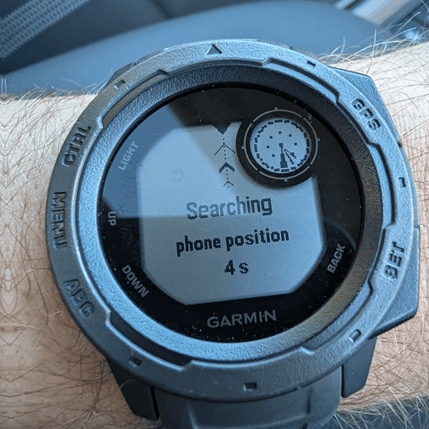
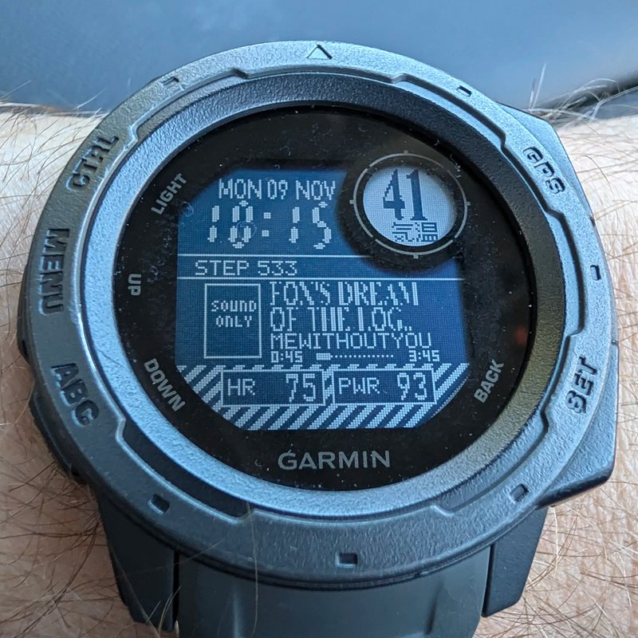
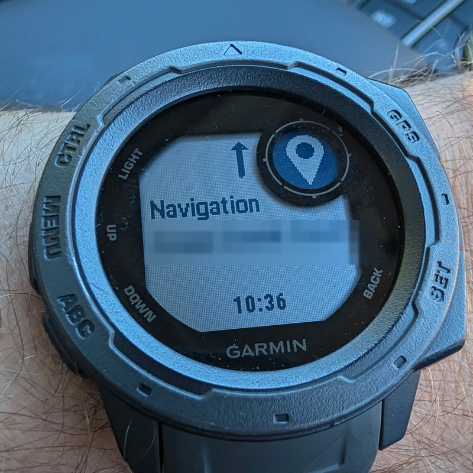
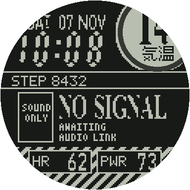
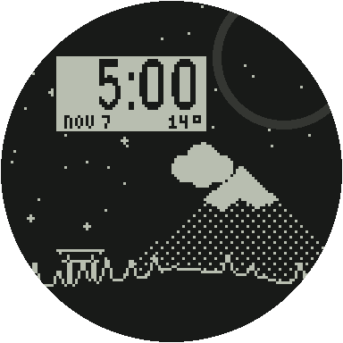
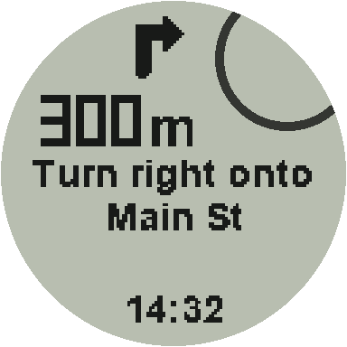

# OpenInstinct

Custom watch faces and custom apps for the **original Garmin Instinct (2018)**, a watch that never got Connect IQ.

<p align="center">
  
  
  
</p>
<p align="center"><sub>On my watch: the plane finder, a face showing the song playing on my phone, and Google Maps navigation (street name blurred).</sub></p>

- **Custom watch faces.** A face is one small file you drag onto the watch over USB. Faces can show the time, date, heart rate, steps, battery, sunrise and sunset, plus weather and the song playing on your phone. 7 faces come prebuilt, the source of 24 is included, and there's a Python kit for making your own with a live preview.
- **A framework for custom apps.** Apps are small Rust programs that open their own pages in the watch's UI, read the buttons, compass and GPS, draw with the watch's own fonts, and reach the internet through your phone.
- **Plane finder** is the worked example app. On the watch face, hold BACK, point 12 o'clock at a plane in the sky and let go. A few seconds later you get its callsign, aircraft type (and route, for airline flights), altitude, speed and distance, with a map of all the traffic around you.
- **Turn-by-turn navigation** from Google Maps on your phone, drawn as a native screen with arrows and distances.

<p align="center">
  
  
  
</p>

## Will it work on my watch?

| | |
|---|---|
| **Supported** | Garmin Instinct, first generation (2018), model **006-B3126**, firmware **19.10** |
| **Not supported** | Instinct 2, 2S, 2X, 3, Crossover, E. They're different hardware. |
| **Untested** | Instinct Solar, Tactical, Esports and Surf editions. They use different firmware files, and the build refuses anything but the exact 19.10 file. |
| **Phone** | Android with [Gadgetbridge](https://gadgetbridge.org) 2026.11.0 or later, for navigation, the plane finder, weather and music. Faces work without a phone. |

Check your watch under **Settings > System > About**. It should say 19.10. If it's on an older version, install Garmin's 19.10 update first.

## Is it safe?

This changes the watch's main firmware. It has been tested on one watch, and **a bad build can make the watch crash or reboot**, and modifying firmware may void your warranty. These safeguards keep you on the recovery path:

- The bootloader and the update code are never touched, so the watch can always take a new update file over USB.
- Garmin's own, unmodified 19.10 file puts the watch back to stock. Our builds mark themselves as version 19.09 so Garmin's file counts as an upgrade. The watch still shows 19.10. In testing, restoring stock kept settings, goals, records and activities untouched.
- Faces run in a guard. A face that crashes the watch once is skipped on the next boot.
- `tools/build.sh` checks your stock file by SHA-256 and checks every patch against the stock bytes before it writes anything.

Read [docs/RECOVERY.md](docs/RECOVERY.md) before your first install. It takes two minutes.

## Install

This repo holds no Garmin code. You build the firmware yourself from your own copy of Garmin's 19.10 update.

1. **Get Garmin's 19.10 update** for the Instinct and find `System_1910/GUPDATE.GCD` inside it. Keep a copy somewhere safe. It's also your way back to stock.
2. **Install the tools**: [Rust](https://rustup.rs) with the 1.98.1 toolchain and its source (`rustup toolchain install 1.98.1 --component rust-src`), plus Python 3 with Pillow (`pip install pillow`).
3. **Build**:
   ```bash
   sh tools/build.sh path/to/System_1910/GUPDATE.GCD
   ```
   This writes `out/GARMIN/GUPDATE.GCD`.
4. **Flash**: charge the watch above 50 %, plug it in, copy `out/GARMIN/GUPDATE.GCD` into the `GARMIN` folder on the watch's drive, eject, and unplug. The watch installs the update and restarts, which takes a few minutes. Don't press buttons while it does.
5. **Add a face**: copy any `.FACE` from [faces/examples](faces/examples) to `GARMIN/FACES/ACTIVE.FACE` on the watch. It shows up on the next minute tick.

To go back to stock, copy Garmin's untouched `System_1910/GUPDATE.GCD` to the watch the same way.

## Using it

### Watch faces

<p align="center"></p>

| File on the watch | What it does |
|---|---|
| `GARMIN/FACES/ACTIVE.FACE` | The face that's drawn. Up to 32 KB. |
| `GARMIN/FACES/OFF` | Any file with this name turns custom faces off. You get the stock face. |
| `GARMIN/FACES/STATE.BIN` | The crash guard's marker. Delete it to retry a face that was skipped. |

The watch's own face settings, including the inset in the top-right porthole, still work. Weather and music come from Gadgetbridge. Turn on weather in Gadgetbridge and play music on the phone.

### Plane finder

<p align="center"></p>

1. In Gadgetbridge, turn on Settings, Location, **Keep location updated**, and give Gadgetbridge location permission. Each aim asks the phone where you are. Without it, the watch's last GPS fix is used, which is only as fresh as your last GPS activity.
2. In Gadgetbridge, turn on internet access for the watch and allow `api.adsb.lol` and `api.adsbdb.com`.
3. On the watch face, **hold BACK**. Point 12 o'clock at the plane, hold steady while the ring fills, then **let go**.

| Button | Card | Map |
|---|---|---|
| UP / DOWN | Next or previous match | Zoom 5, 10, 25 nm |
| GPS (top right) | Open the map | Back to the card |
| Hold BACK | Aim again | Aim again |
| BACK | Close | Back to the card |

It searches 25 nm around you and picks the plane nearest your aim, leaning hard toward closer planes. The compass gives a direction but not how high you're pointing, so a plane a mile away near your aim beats a jet at contrail height 20 miles off, even when the compass is up to 40° off. A plane right overhead still counts. In a busy sky it searches again at 10 nm when the 25 nm reply is too big.

While it searches, the screen says which position it's using: "phone position" (a fix from the last 30 minutes, good to 1 km) or "watch GPS fix". An old position throws off the bearing to nearby planes, so if it says "watch GPS fix", check the Gadgetbridge setting above. If it keeps picking the wrong plane, calibrate the compass (watch settings, Sensors, Compass).

The card shows the callsign in bold, the type, the altitude with a climb or descent arrow, and the speed and distance on the bottom row (the speed drops off when the row is too narrow for both). The small plane on the rim is where it sits from 12 o'clock: under the notch means you're on it, and the dotted trail shows which way to turn. If the compass can't help, the card shows a direction (N, SE...) at the top instead.

For airline flights the card swaps between the type and the route (LIS ✈ OPO) every 3 seconds. That costs one small request per flight you look at, and a route that doesn't fit where the plane actually is gets dropped (callsigns get reused). When there's no route, the type swaps with the reason instead: "route unknown" (adsbdb has no route for that callsign), "route out of date" (it has one, but the plane isn't on it, often another leg of the same flight number) or "route: no reply" (nothing came back; check that `api.adsbdb.com` is allowed in Gadgetbridge). Private flights flying under their registration (N123AB) never get a route. Aircraft data comes from [adsb.lol](https://adsb.lol), a community ADS-B network, and routes from [adsbdb](https://www.adsbdb.com).

Trade-off: after this install, a quick BACK press on the face fires when you let go instead of when you press. That's how the watch tells a press from a hold. To turn the plane finder off, put a file named `PLANEOFF` in `GARMIN/FACES`.

### Turn-by-turn navigation

Gadgetbridge 2026.11.0 or later forwards Google Maps directions to the watch. In Gadgetbridge, allow notifications from Google Maps. On the phone, turn off the "Live Updates" notification style for Maps (**Settings > Apps > Maps > Notifications**). With it on, Gadgetbridge can't read the directions. Start navigating in Maps and the watch shows each turn, buzzing as you get close.

### Battery

Nothing here adds a timer that runs on its own. Faces repaint when the stock face would, once a minute, or about 4 times a minute while music plays. The plane finder only runs the compass while you aim and only goes online when you ask. Navigation only wakes when your phone sends a step.

## Make your own

- [docs/FACES.md](docs/FACES.md): make a watch face in Python, preview it on your PC, and check it against the round screen. Start from [faces/src/hello.py](faces/src/hello.py).
- [docs/APPS.md](docs/APPS.md): how apps hook into the watch, with the plane finder as the worked example.
- [docs/DEVELOPING.md](docs/DEVELOPING.md): the repo layout, the build, the tests, the mock screens and how patches are checked.
- [AGENTS.md](AGENTS.md): rules for AI coding agents working on this repo.

## Credits

[Gadgetbridge](https://gadgetbridge.org) does all the phone-side work: navigation, weather, music, and the internet proxy the plane finder uses. Aircraft data comes from [adsb.lol](https://adsb.lol) and routes from [adsbdb](https://www.adsbdb.com).

OpenInstinct isn't affiliated with or endorsed by Garmin. Garmin and Instinct are trademarks of Garmin Ltd. or its subsidiaries. This repository contains no Garmin firmware.

## License

[MIT](LICENSE)
